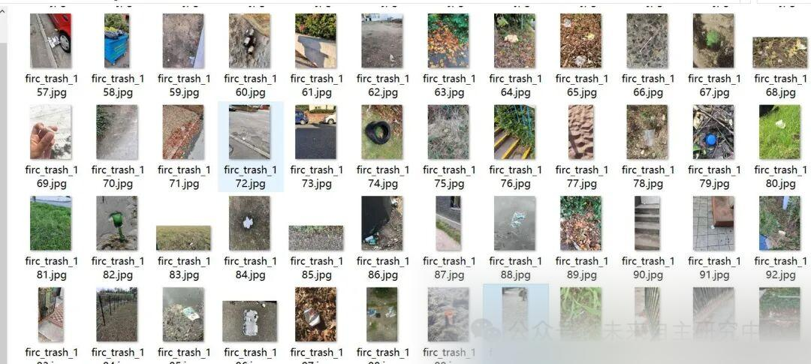
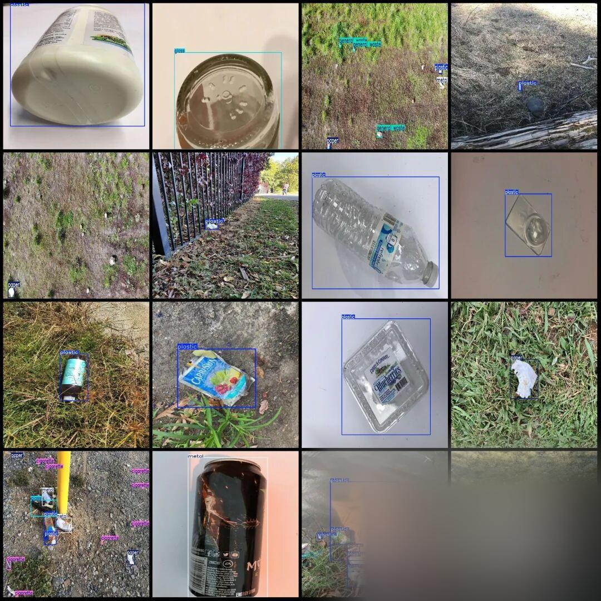

# VOC+YOLO format, 6459 images in 9 categories for garbage detection dataset

Dataset format: Pascal VOC format + YOLO format (txt file without split path, only containing jpg images and corresponding VOC format xml files and yolo format txt files)

Number of images (number of jpg files): 6459

Number of annotations (number of xml files): 6459

Number of annotations (number of txt files): 6459

Label category count: 9

Label category names (Note that the order of categories in the Yolo format does not correspond to this, but is based on the labels folder's classes.txt): ["aluminium wrap", "cardboard", "cigarette", "general waste", "glass", "metal", "paper", "plastic", "styrofoam"]

Number of boxes labeled in each category:

Aluminum wrap frame count = 223

Cardboard frame count = 651

Number of cigarette frames = 768

General waste frame count = 1896

Number of glass frames = 1579

Metal frame count = 1525

Number of paper frames = 2790

Plastic frame count = 6050

Styro foam frame count = 501

Total frames: 15983

Using labelImg:

Annotation rules: Draw a rectangle around the category.

Important Notice: No

Special : This dataset does not guarantee the accuracy or precision of the trained models or weight files. The dataset is provided with accurate and reasonable annotations only.

Image Preview:

Annotation example:

## Payment

Here is a pay link on Stripe ( https://buy.stripe.com/3cs8yP7sY87d0vu9AB ). Please contact me lonlonago@foxmail.com after funding $89, and I will send you a complete data files , thank you!

